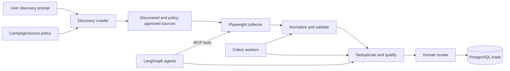

# AI Lead Intelligence and Scraping System

[](https://github.com/bungkot/AIliss/actions/workflows/ci.yml)

A repository for designing and eventually implementing an AI-assisted lead discovery, extraction, qualification, enrichment, and governance platform. This repository currently contains documentation and the GitHub Copilot development harness only; it deliberately has no application implementation or dependencies.

## Project purpose

Discover companies and contacts through prompt-driven crawling, then convert policy-approved public sources into traceable, reviewable sales leads with deterministic pipelines, bounded LangGraph agents, Playwright browser extraction, MCP tools, asynchronous workers, and human review.



## Repository boundaries

- **Documentation phase:** requirements, architecture, contracts, harness, ADRs, and operational readiness.
- **Not implemented:** application source trees, migrations, package manifests, worker code, browser automation, or services.
- Future implementation must follow the [Project Constitution](docs/00-project-constitution.md) and [Testing and Evaluation](docs/12-testing-and-evaluation.md).

## Local RND profile

The minimum implementation environment is FastAPI, SQLModel, SQLite, host Ollama with `qwen3:0.6b`, and Playwright. PostgreSQL, Redis, Celery, object storage, and observability remain production or explicit testing profiles. See the [local RND profile](docs/02-system-architecture.md#rnd-docker-desktop), [deployment profile](docs/13-deployment-and-infrastructure.md#rnd-docker-desktop), and [ADR-007](docs/adr/ADR-007-local-rnd-profile.md).

## Documentation map

| Area | Documents |
|---|---|
| Strategy | [Product requirements](docs/01-product-requirements-document.md), [Roadmap](docs/16-roadmap.md), [Development workflow](docs/15-development-workflow.md) |
| Architecture and agents | [Architecture](docs/02-system-architecture.md), [Domain](docs/03-domain-model.md), [Workflow](docs/04-agentic-workflow.md), [Context](docs/05-context-engineering.md), [Harness](docs/06-agent-harness-engineering.md), [MCP](docs/07-mcp-architecture.md) |
| Extraction and data | [Playwright](docs/08-playwright-extraction.md), [Data pipeline](docs/09-data-pipeline.md), [API](docs/14-api-specification.md) |
| Production | [Security](docs/10-security-and-compliance.md), [Observability](docs/11-observability.md), [Testing](docs/12-testing-and-evaluation.md), [Deployment](docs/13-deployment-and-infrastructure.md), [Runbook](docs/17-operational-runbook.md), [Cost](docs/18-cost-optimization.md) |
| Decisions | [Architecture Decision Records](docs/adr/README.md) |

## Development harness

The `.github/` tree contains instructions, specialist agents, prompts, and skills. Read [.github/copilot-instructions.md](.github/copilot-instructions.md), then load only the scoped instruction or skill relevant to the change.

## Readiness and validation

Start with the [Project Constitution](docs/00-project-constitution.md), review [implementation readiness](docs/implementation-readiness.md), and confirm the source/privacy gates before implementation. Live extraction and production deployment are not authorized by this repository.

Run:

```bash
python scripts/validate_docs.py
```

## Phase 1 local RND

Create a virtual environment and install the application plus development dependencies:

```powershell
py -3.12 -m venv .venv
.venv\Scripts\Activate.ps1
python -m pip install -e ".[dev]"
```

Run migrations and the API without Docker:

```powershell
python -m alembic upgrade head
python -m uvicorn ailiss.main:app --host 127.0.0.1 --port 8000 --reload
```

Run the local acceptance suite:

```powershell
python -m pytest
python scripts\validate_docs.py
```

Docker containers must remain stopped for normal Phase 1 work. Start a container only for a
later slice that explicitly validates an optional infrastructure or browser contract.

## Phase 1 Docker smoke test

The API-only Docker profile runs FastAPI and the local SQLite file without PostgreSQL, Redis,
Celery, browser, Ollama, MinIO, or observability containers:

```powershell
docker compose up --build -d api
curl.exe --fail http://127.0.0.1:18000/health
docker compose logs api
docker compose down
```

The profile is capped at one API container, 768 MiB memory, and 1.5 CPUs. Stop all containers
before and after development; start optional browser, storage, or observability profiles only
when the relevant phase or slice requires them.

## Phase 2 RND boundary

Phase 2 uses deterministic HTML fixtures, policy-gated artifact staging, provenance-bearing
evidence, normalized names/domains, and reversible merge decisions. Live browser navigation is
not enabled by the API: Playwright is an optional implementation profile and fixture tests
must remain isolated from campaign identity and shared browser state.