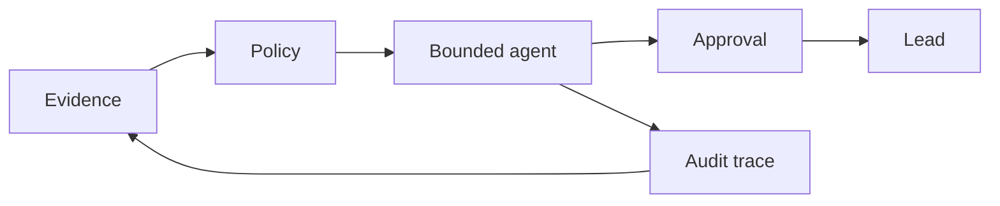

# Project Constitution

## North Star

Every extracted fact must be attributable, every agent action bounded, and every promotion to a usable lead policy-gated and reviewable.

## Principles

1. **Evidence over confidence:** retain source, timestamp, extractor, raw payload hash, and verification status.
2. **Policy before automation:** discovery starts from the user's prompt and campaign constraints; extraction and enrichment proceed only after discovered sources pass policy checks and allowed fields are enforced.
3. **Determinism by default:** validate, normalize, deduplicate, and retain before invoking an LLM.
4. **Progressive disclosure:** agents receive the minimum context needed for each step.
5. **Replaceable providers:** interfaces isolate Ollama, hosted providers, MCP servers, browser engines, and storage.
6. **Human control:** promotion, outreach, deletion, and policy exceptions require authorization.
7. **Production economics:** enforce rate, token, crawl, retry, and retention budgets.

## Repository boundaries

No application code belongs in this documentation phase. Implementation additions require a package manifest, migrations, source layout, and tests before feature code.

## Quality gates

- Requirements trace to architecture, data contracts, and tests.
- No unapproved source, secret, personal field, or external write action.
- Extraction includes provenance and confidence.
- Duplicate leads converge deterministically.
- Security, performance, cost, and recovery targets are measured.
- Documentation and generated contracts remain synchronized.
