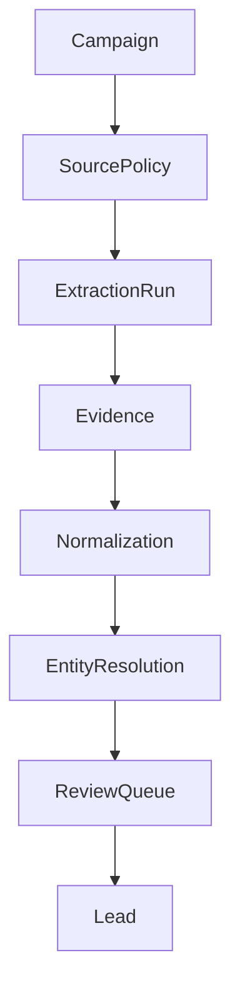

# Product Requirements Document

## Product summary

The system discovers companies and contacts by crawling and following leads derived from the user's discovery prompt, extracts factual information only from policy-approved discovered sources, enriches selected fields, clusters likely duplicates, scores leads against explicit rules, and routes uncertain results for human review.

## Functional requirements

- Register campaigns, discovery prompts, source policies, and extraction goals.
- Discover candidate URLs/domains through bounded crawling based on the campaign prompt and constraints.
- Run and monitor browser extraction jobs only across discovered URLs that pass policy checks.
- Normalize websites, business entities, addresses, roles, emails, and phone records.
- Create provenance-bearing `Company`, `Contact`, and `Lead` records.
- Deduplicate by canonical identifiers, domain, normalized name, and configurable similarity rules.
- Support AI-assisted classification, qualification, summarization, and field selection with provider fallback.
- Import and export leads with traceable batch provenance.
- Pause jobs, quarantine records, and require operator approval for promotion or outreach.

## Non-functional requirements

| Requirement | Target or control |
|---|---|
| Availability | Idempotent jobs, degraded local provider mode, alertable worker health |
| Security | Tenant isolation, least privilege, secret management, audit logging |
| Performance | Defined stage throughput and backpressure targets |
| Privacy | Data minimization, purpose/retention metadata, access and deletion workflows |
| Explainability | Provider, prompt/version, tool calls, inputs, and confidence retained |
| Portability | Ollama, hosted provider, MCP, browser, and storage adapters |

## Release requirements

A release requires passing unit/integration/evaluation suites, security review, cost projection, migration plan, rollback plan, and operational ownership.
