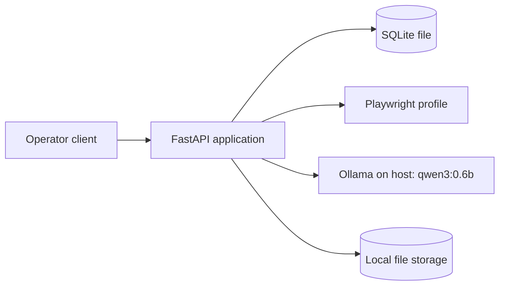
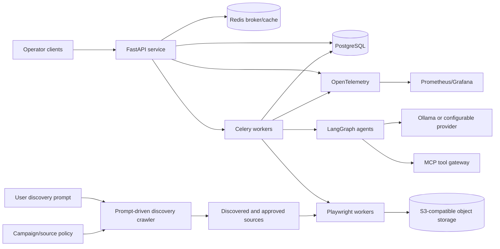

# System Architecture

## Architecture overview

The system is designed as a modular monolith API with replaceable persistence and execution profiles, Playwright extraction, LangGraph orchestration, MCP tools, object storage, and provider-agnostic LLM adapters.

Use a deployment profile rather than changing the product architecture for different environments:

- **RND local profile:** one laptop, Docker Desktop memory capped at approximately 3.5 GiB, FastAPI plus SQLite/SQLModel, Ollama with a small reasoning model, and an explicitly started Playwright profile.
- **Production profile:** the full topology in this document, with separate replicated services and managed dependencies.

The local profile must preserve the same API, domain model, schemas, migrations, provenance, policies, and deterministic test contracts as production.

SQLite and SQLModel in the local profile are a deployment adaptation, not a different domain model. SQLModel is the repository-wide persistence API, backed by SQLite in RND and PostgreSQL in production. SQLAlchemy remains an internal ORM implementation dependency rather than an application-layer API.

## RND Docker Desktop topology

The default local stack is intentionally small:

- Run FastAPI plus SQLModel/SQLite in the core local stack; PostgreSQL and Redis are not required.
- Keep Ollama available on the Windows host with `qwen3:0.6b` and one active model request at a time.
- Start Playwright on the host or as a separate optional profile when browser behavior is being developed or tested.
- Use a local single-process or in-process task runner for RND; add Redis/Celery only when restart recovery, scheduling, or concurrency requires a queue.
- Do not start browser and agent containers by default; launch them only with explicit Docker Compose profiles.
- Store snapshots, exports, and screenshots in a local directory instead of starting MinIO.
- Do not start an Ollama container by default; use the Windows host Ollama service.
- The default RND reasoning profile is `qwen3:0.6b`. It is small enough to keep the local LLM available alongside the core stack. Upgrade only to `qwen3:1.7b` or `qwen3:4b` when offline quality tests require it.
- Use the application log output and OpenTelemetry instrumentation without starting Prometheus and Grafana locally.

Example suggested memory limits for Docker Desktop:

| Component | Suggested limit |
|---|---:|
| Application/API/local worker | 300-768 MiB |
| SQLite | file-backed; no separate container |
| Ollama qwen3:0.6b on host | approximately 700 MiB model memory |
| Playwright browser profile (optional) | 768-1024 MiB |
| MinIO storage profile (optional) | 256-512 MiB |
| Prometheus profile (optional) | 256-512 MiB |
| Grafana profile (optional) | 256-512 MiB |
| Ollama | run on the Windows host and excluded from Docker memory limits |

Keep the total core stack below the Docker Desktop limit and stop optional profiles when not in use. Browser and LLM components may be installed locally outside Docker during development if they are not needed for a specific test.

## Production topology

## Component responsibilities

- **FastAPI/Pydantic v2:** API validation, authorization, request tracing, and lifecycle commands.
- **SQLModel/Alembic:** typed persistence entities, sessions, migrations, transactions, and SQLModel repository boundaries. SQLAlchemy is used only as the underlying ORM implementation.
- **Celery/Redis:** task dispatch, retries, schedules, and rate-control queues in production. Local RND uses SQLite plus a bounded in-process task runner until durable queue behavior is required.
- **PostgreSQL:** source of truth for entities, jobs, provenance, and approvals.
- **Playwright:** isolated Chromium extraction, network capture, and authorized screenshots.
- **LangGraph:** bounded state machines for planning, verification, qualification, and recovery.
- **MCP:** capability-oriented tools with explicit schemas and authorization scopes.
- **Ollama:** configurable local provider; hosted providers implement the same adapter contract.
- **S3:** snapshots, screenshots, parser artifacts, and exports with retention.
- **OpenTelemetry, Prometheus, Grafana:** traces, metrics, dashboards, and alerts.

## Technology decisions

Python 3.12+ is mandatory. Prefer typed FastAPI routes, dependency injection, structured Pydantic settings, SQLModel entities, Alembic migrations, repository/service boundaries, and immutable job commands. Keep direct SQLAlchemy declarative imports out of API and domain modules. Split worker pools before adding services.

## Failure boundaries

The API validates and commands; workers execute; agents may propose but cannot mutate high-risk facts directly. Network, browser, model, MCP, and storage failures are isolated with typed outcomes and retries.
