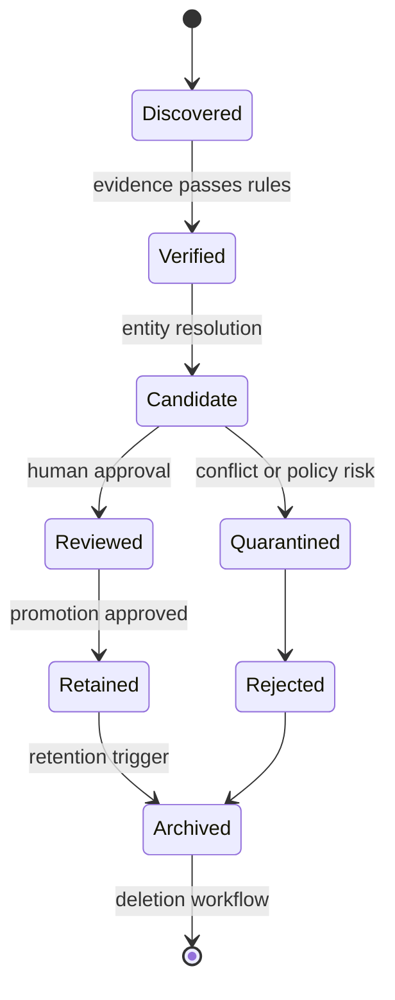

# Domain Model

## Core entities

- **Company:** canonical organization identity, domain, status, and retention policy.
- **Contact:** person or role associated with a company, with purpose and consent metadata where applicable.
- **Lead:** promoted or candidate opportunity combining company, contact, evidence, score, and disposition.
- **Source:** discovered URL/domain plus approval status, policy, owner, access basis, and fetch constraints.
- **Campaign:** bounded objective, user discovery prompt, discovery constraints, source policy, field requirements, budgets, and owners.
- **ExtractionRun:** immutable execution summary for one campaign/source/browser revision.
- **Evidence:** raw or normalized observation with value, confidence, provenance, and verification state.
- **Approval:** named review decision linked to actor, reason, state, and timestamp.

## Entity lifecycle

## Provenance and lineage

Every `Evidence` stores source URL or file identity, campaign/run IDs, fetched timestamp, extractor version, model/version when applicable, raw artifact hash, normalization version, parent evidence, and operator overrides.

## Deduplication

Use canonical domain/identifier keys first, exact normalized identity second, and configurable similarity candidates third. Do not merge automatically without threshold, conflict check, audit event, and reversal data. Each merge records kept ID, merged IDs, match evidence, and actor/service decision.

## Retention

Retention belongs to Campaign and data class. Personal or sensitive fields require explicit purpose and shorter retention assumptions. Raw artifacts, audits, and business records may use different schedules.

## Invariants

- No Lead without provenance-bearing evidence or explicit import provenance.
- Promotion changes require approval.
- Corrections append facts rather than silently overwrite.
- Deletes preserve minimum compliance and audit metadata where permitted.
