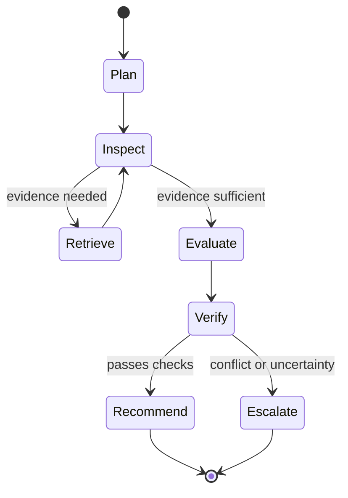

# Agentic Workflow

## Workflow overview

Agents orchestrate investigation and recommendation; deterministic services own parsing, validation, mutation, authorization, and promotion.

## Bounded agent loop

Each graph run has maximum steps, tool calls, tokens, wall time, bytes, and spend. Use typed state; checkpoint approved state only; stop on exhausted budgets; and emit complete, partial, blocked, retryable, or policy-rejected outcomes.

## Autonomous operations

Autonomous mode may plan prompt-driven discovery, crawl candidate sources within campaign and budget limits, submit discovered URLs for policy approval, normalize data, generate candidates, score records, and enqueue reviews. It may not bypass policy, extract from a discovered source before approval, export personal data, send outreach, merge records, approve leads, disable controls, or change retention rules without authorization.

## Handoff rules

Architect owns contracts; backend implements persistence/API; browser engineer owns browser isolation; AI engineer owns graphs/providers/context; test engineer owns coverage; security reviewer verifies controls; code reviewer checks defects and scope; humans approve high-impact transitions.

## Failure handling

Classify errors by retryability, policy, dependency, model, and data. Backoff is capped; mutations are idempotent; compensation is logged; repeated policy failures do not retry automatically.
