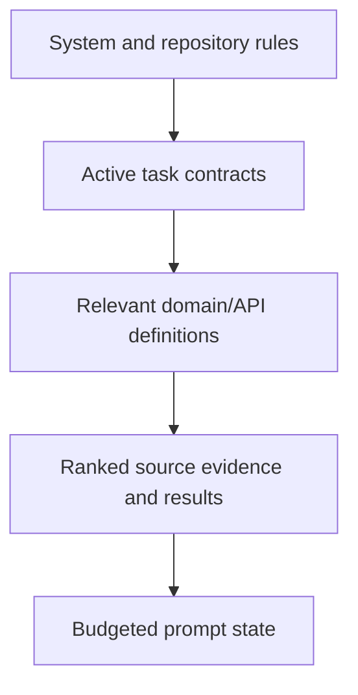

# Context Engineering

## Context hierarchy

Load repository constitution, requirements, architecture/ADRs, active task, relevant domain contracts, current evidence, and narrow tool outputs in layers.

## Progressive disclosure

Start with summaries and contracts. Load source files only as symbols become relevant. Fetch MCP schemas and tool results only for the next action. Return concise summaries plus artifact references instead of embedding raw pages.

## Context budgets

Enforce prompt, document, evidence, tool-output, and output budgets. Rank evidence by relevance, authority, freshness, and policy. Deduplicate payloads, preserve provenance hashes, cap retries, and stop when evidence quality cannot improve.

## Prompt and state policy

Prompts and versions are configuration. Store provider/model/settings, tool allowlist, redaction flags, citations, terminal result, and budget usage with each run. Secrets and unrestricted datasets never enter prompts.
