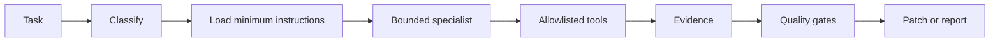

# Agent Harness Engineering

## Harness responsibilities

The harness coordinates repository instructions, scoped file instructions, specialist skills, prompts, tools, tests, and evidence. It remains deterministic enough to reproduce decisions while allowing provider substitution.

Use the correct harness entry in [current instructions](../.github/copilot-instructions.md), then load one relevant skill and its agent.

## Progressive skill loading

Skills contain reusable procedures and are loaded only for matching tasks. Instructions are scoped by glob. Agents have explicit responsibilities and handoff criteria; prompts define repeatable workflows.

## Quality gates

- Scope and requirements traceability.
- Python/static conventions and targeted tests.
- Documentation links/headings and optional Mermaid syntax.
- Security and privacy review.
- Cost/time/budget estimate.
- Final review for unintended scope, migrations, or destructive changes.

## Resource and cost engineering

Cap model calls by steps, tokens, tool calls, wall clock, concurrency, and spend. Browser workers cap tabs, memory, concurrency, page bytes, timeouts, and artifacts. Isolate expensive extraction queues from interactive traffic.
