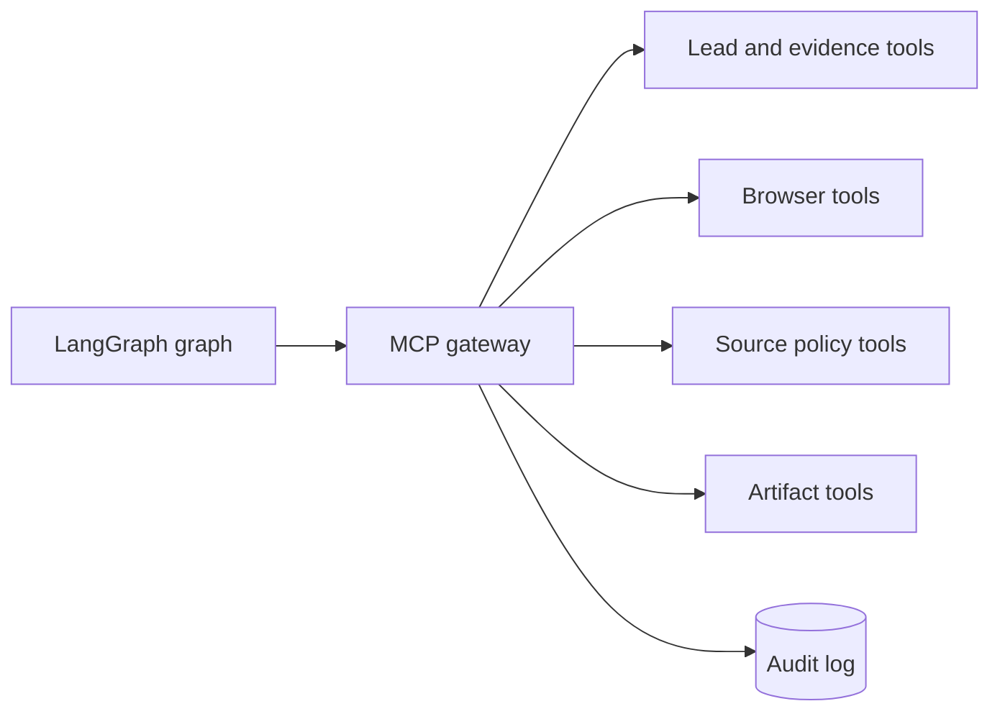

# MCP Architecture

## MCP topology

MCP servers expose narrow capabilities behind an authenticated gateway. Every tool declares input/output schemas, authorization scope, side-effect class, idempotency key, timeout, and audit requirements.

## Tool specifications

| Tool | Read/Write | Required fields |
|---|---|---|
| `campaign.get` | Read | campaign_id |
| `discovery.run` | Write | campaign_id, prompt, config_hash, idempotency_key |
| `discovery.candidates` | Read | campaign_id, discovery_run_id |
| `source.policy_check` | Read | campaign_id, URL |
| `extraction.create_run` | Write | campaign_id, source_id, config_hash |
| `browser.fetch` | Write | run_id, URL, timeout, idempotency_key |
| `evidence.normalize` | Write | run_id, artifact_id, schema_version |
| `lead.candidate_create` | Write | campaign_id, evidence_ids, idempotency_key |
| `approval.request` | Write | lead_id, decision_class, reason |

Return typed success, not-found, denied, invalid-input, transient, timeout, or conflict outcomes. Raw payloads are artifacts or hashes unless bounded values are contractually required.

## Security boundaries

Validate caller identity, source allowlist, tenant scope, data class, and side-effect policy. Secrets never appear as tool parameters. Browser navigation rejects private networks and schemes unless separately authorized.
