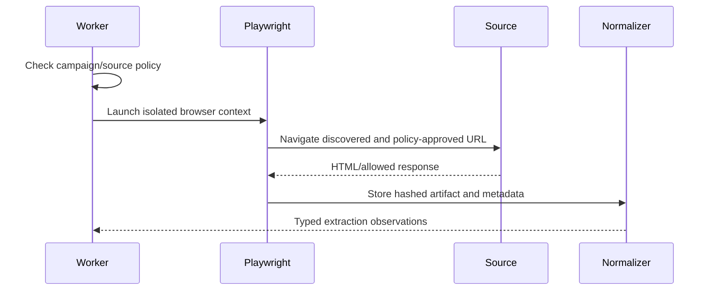

# Playwright Extraction

## Extraction architecture

Browser workers use Playwright Chromium behind typed extractors. Each URL passes policy validation before navigation; pages, network responses, and parsed results are staged by run and artifact ID.

## Browser lifecycle

Create a fresh context per trust boundary, configure locale/timezone explicitly, isolate cookies and storage, use fixed timeouts, close contexts/pages in cleanup, and terminate browser processes. Reuse workers only; never reuse identity sessions across campaigns.

## Anti-blocking and resilience

Prefer stable DOM and APIs over layout-specific selectors. Detect challenge pages and CAPTCHA; never bypass. Retry only transient network failures with fixed identities, capped backoff, and source-specific limits. Record status, content type, bytes, hash, and retry reason.

## Extraction contracts

Return typed `Evidence` candidates and parser errors. Screenshots require authorization and retention policy; redact secrets, never capture authentication forms, and include browser/parser versions in provenance.
