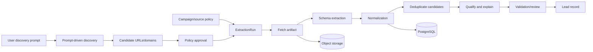

# Data Pipeline

## Pipeline stages

A campaign starts from a user discovery prompt and runs one or more discovery and `ExtractionRun` records. Discovery produces candidate sources, which become eligible for crawling only after policy approval. Browser results become hashed artifacts; parsers normalize observations; entity resolution clusters candidates; policy/model outputs produce recommendations; human review controls promotion.

## Deduplication and retention

Run deterministic identity keys before similarity scoring. Quarantined candidates stay non-promoted. Merge, correction, archive, purge, and restoration operations are audited and reversible according to policy.

## Async processing

Tasks receive immutable IDs and config hashes, not large untrusted payloads. Every task is idempotent, bounded, retryable only when marked transient, and observable by run/source/entity IDs.

## Backpressure

Apply source and campaign rate limits. Browser tabs, artifact bytes, model concurrency, queue depth, and database connections have ceilings; overload pauses work for review rather than bypassing policy.
