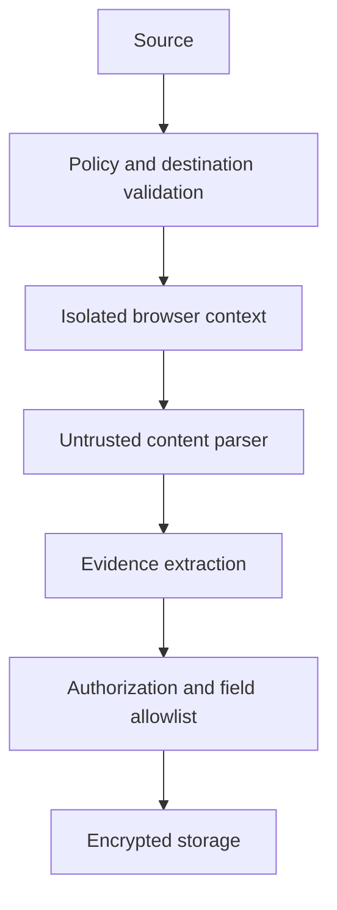

# Security and Compliance

## Threat model

Threats include malicious websites, SSRF/private-network access, prompt/tool injection, credential exposure, overcollection, unauthorized export, supply-chain compromise, destructive automation, and incorrect lead decisions.

## Indonesia PDP assessment

This is an engineering compliance assessment, not legal advice. For Indonesian Personal Data Protection Law (UU PDP) considerations, map personal data, purpose, lawful basis/consent expectations, notice/transparency, security, controller/processor roles, minimization, retention, rights, cross-border transfer, and incident response. Obtain qualified legal review before production.

## Data controls

- Encrypt secrets and sensitive data in transit and at rest; rotate credentials.
- Enforce tenant, campaign, and data-class authorization at service and query boundaries.
- Separate public business facts from potentially personal or sensitive fields.
- Redact secrets from logs/artifacts and restrict screenshot/export access.
- Support correction, export, deletion, and retention workflows with audit entries.
- Validate MCP tools, browser destinations, file formats, and model outputs as untrusted input.

## Security review gate

Release requires threat/dependency review, secrets scanning, SSRF/browser isolation tests, authorization tests, audit tests, privacy retention review, and incident/abuse response readiness.
