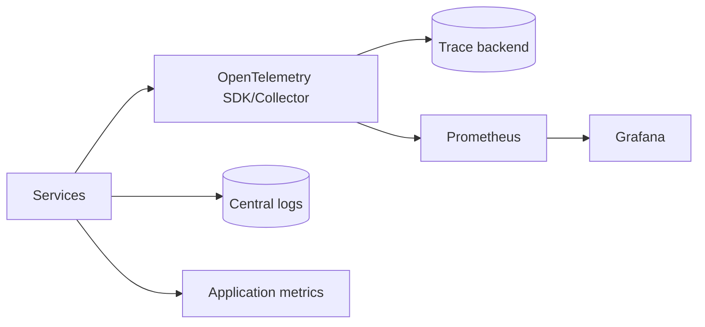

# Observability

## Signals and ownership

Emit structured logs, metrics, and OpenTelemetry traces for API, browser, pipeline, agent, MCP, provider, database, and storage operations. Every alert has an owner, runbook, and severity.

## OpenTelemetry

Use stable resource attributes and correlation IDs for campaign, run, source policy, browser extractor, task, model, and tenant where authorized. Do not place content, secrets, names, or unrestricted personal fields in span attributes.

## Prometheus and Grafana

Track request/error/latency metrics, queue depth/lag, worker/browser utilization, extraction/challenge outcomes, data quality, duplicate merges, model latency/token/cost estimates, retries, storage growth, and approval backlog.

The Phase 4 application exposes `/metrics` for a basic request counter and
`/health/live` plus `/health/ready` for process and database dependency probes.
OpenTelemetry and managed Prometheus/Grafana integration remain optional until
their production profile and collectors are activated.

## SLOs and alerts

Document availability, extraction freshness, worker lag, browser/provider failure, queue backlog, evidence completeness, and safety-violation targets before production. Alerts distinguish dependency, policy, and quality failures.
