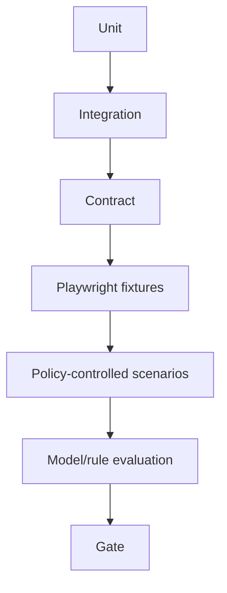

# Testing and Evaluation

## Test strategy

Use unit tests for pure parsing/rules/deduplication; local integration tests for FastAPI/SQLModel/SQLite and optional Ollama/Playwright profiles; production integration tests for PostgreSQL/Redis/Celery/MCP/storage when those contracts are changed; contract tests for provider/tool boundaries; Playwright fixtures; and end-to-end policy-controlled scenarios.

## Evaluation metrics

- Extraction precision/recall and field-level completeness.
- Schema validity, provenance completeness, and source-policy compliance.
- Duplicate precision/recall and harmful merge rate.
- Lead qualification calibration or fixed baseline comparison.
- Agent task success, tool validity, step count, fallback rate, and terminal outcome accuracy.
- Authorization, privacy, source-abuse, and injection refusal outcomes.
- Browser recovery, retry efficiency, and page-byte/time budgets.

## Quality gates

- No source-policy or authorization regression.
- No known migration/data-loss issue.
- Targeted tests pass for every Python change.
- Fixtures cover success, malformed data, challenge, timeout, conflict, and budget exhaustion.
- Evaluation thresholds are configured and reported; lowering a threshold requires review.
