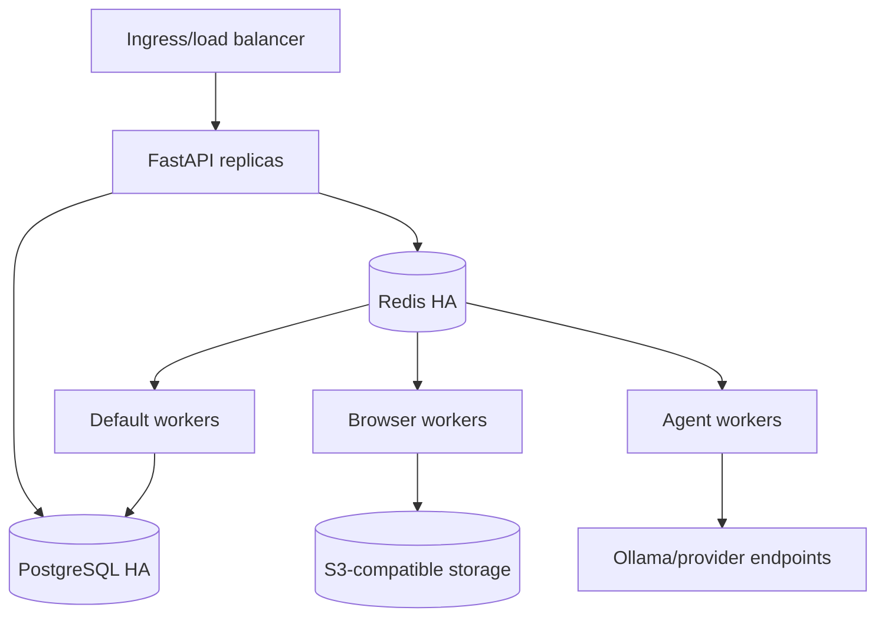

# Deployment and Infrastructure

## Target topology

### RND Docker Desktop

Current development machine baseline detected by Docker:

- Docker Desktop engine memory: approximately 3.70 GiB.
- Docker Desktop engine CPUs: 4 logical CPUs.
- Total is shared; reserve roughly 1.0-1.2 GiB for Windows, Docker Desktop, VS Code, browsers, and Ollama.

The minimum local composition is FastAPI plus SQLite, implemented with SQLModel, a Windows-host Ollama service, and Playwright available as the browser profile. PostgreSQL, Redis, Celery, MinIO, Prometheus, and Grafana are not part of the minimum RND stack.

The following container profiles are the recommended targets. Limits are upper safeguards, not guarantees that the container will use the full allocation.

| Container/profile | Purpose | CPU limit | Memory limit | Required |
|---|---|---:|---:|---|
| `api` | FastAPI plus SQLModel/SQLite and bounded local tasks | 1.0-1.5 CPU | 300-768 MiB | Core |
| `sqlite` | Single local database file outside a container | no separate process | file-backed | Core |
| `browser` | Playwright/Chromium extraction profile | 1.0-2.0 CPU | 768-1024 MiB | Optional |
| `minio` | S3-compatible local object storage | 0.25-0.5 CPU | 256-512 MiB | Optional |
| `prometheus` | Metrics collection and validation | 0.25-0.5 CPU | 256 MiB | Optional |
| `grafana` | Dashboards and visualization | 0.25-0.5 CPU | 256-512 MiB | Optional |

`ollama` is a Windows host service in the minimum RND profile. The default model is `qwen3:0.6b`. Do not add Ollama or a PostgreSQL/Redis stack to Docker Compose by default.

Recommended combinations:

| Combination | Containers | Maximum target memory | When to use |
|---|---|---:|---|
| Core API | `api + sqlite file` | 300-768 MiB | Normal implementation, unit/integration tests, migrations |
| API plus browser | `api + sqlite file + browser` | 1.0-1.7 GiB | Extraction fixtures and a single browser context |
| API plus local AI | `api + sqlite file + host Ollama qwen3:0.6b` | Docker 300-768 MiB plus approximately 0.7-1.0 GiB model memory | Agent reasoning and provider integration tests |
| Browser plus local AI | `api + sqlite file + browser + host Ollama qwen3:0.6b` | Docker 1.0-1.7 GiB plus approximately 0.7-1.0 GiB model memory | End-to-end extraction and reasoning tests |
| Full optional services | Core/API plus MinIO, Prometheus, Grafana, browser | 2.5-3.0 GiB | Only one profile or validation topic at a time |

Avoid running browser, Ollama, MinIO, Prometheus, and Grafana simultaneously. For Ollama use the Windows host and start only:

- `qwen3:0.6b` for the default minimum local reasoning profile.
- `smollm2` as an ultra-small non-reasoning-oriented fallback when even the 0.6B model is too expensive for a simple extraction or classification workload.
- `qwen3:1.7b` only when the 0.6B model fails the offline quality threshold.
- `qwen3:4b` only after the 1.7B model fails and the laptop still has sufficient memory.
- The browser or Ollama service should normally be stopped while the other is not active.

The minimum RND profile can run FastAPI and SQLite directly in one local process without Docker Compose. Docker Compose may wrap only the API; SQLite remains a local file.

Optional Compose profiles are:

- `browser`: Playwright worker/browser
- `ollama`: local LLM container
- `storage`: S3-compatible storage such as MinIO
- `observability`: Prometheus and Grafana

The core stack is the default and should remain below approximately 0.75 GiB without optional browser/storage/observability components. Use host Ollama for local-model behavior. Use local filesystem storage unless object-store behavior itself is being validated.

### Production topology

Deploy FastAPI, Celery worker pools, Playwright/browser workers, Redis, PostgreSQL, and object storage as managed components. Browser workers have limited destinations and no direct database credentials unless required.

## Deployment process

Migrations, applications, and workers must remain compatible through rolling or preflight release strategy. Freeze task schema/config versions; use feature flags for provider/agent modes. Health checks cover API, database, queue, browser, and provider.

## Infrastructure decisions

Versioned infrastructure owns network, identities, secrets, storage, database, telemetry, and backups. Images are pinned and scanned. Replacing Celery requires an ADR and migration criteria; setup cost alone is insufficient.

## Recovery

Document backup/restore, Redis loss, queue pause, provider outage, browser region loss, object-store loss, migration rollback, and lead purge/resume procedures.
