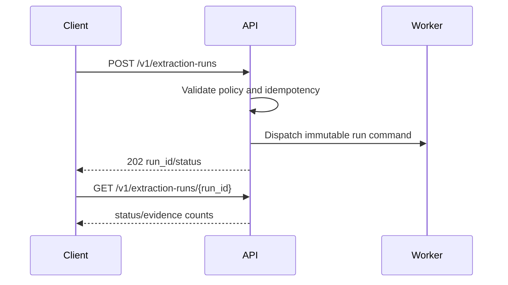

# API Specification

## API conventions

FastAPI exposes versioned REST JSON endpoints. IDs are UUIDs or ULIDs. Mutations accept optional `Idempotency-Key`; timestamps use UTC ISO-8601; pagination uses cursor/limit. Pydantic v2 separates create, update, response, and internal models.

## Endpoint catalog

| Method and path | Purpose |
|---|---|
| POST /v1/leads/import | Start a provenance-bearing lead import |
| GET /v1/leads/{lead_id} | Retrieve lead and evidence summary |
| POST /v1/extraction-runs | Start an extraction run |
| GET /v1/extraction-runs/{run_id} | Get run status and audit summary |
| POST /v1/campaigns/{campaign_id}/pause | Pause queued work |
| POST /v1/leads/{lead_id}/approve | Record authorized promotion approval |

Phase 1 also exposes campaign source-policy and source registration contracts:

| Method and path | Purpose |
|---|---|
| POST /v1/campaigns | Create a campaign |
| POST /v1/campaigns/{campaign_id}/pause | Pause campaign work |
| POST /v1/campaigns/{campaign_id}/source-policy | Create the campaign source policy |
| POST /v1/campaigns/{campaign_id}/sources | Register a policy-approved source |

## Error model

Return stable codes, correlation IDs, field errors, retry hints, and no raw secrets or prompts. Use 400 validation, 401 authentication, 403 authorization/policy, 409 conflict, 422 semantic validation, 429 rate limit, 503 dependency, and 202 async responses.
