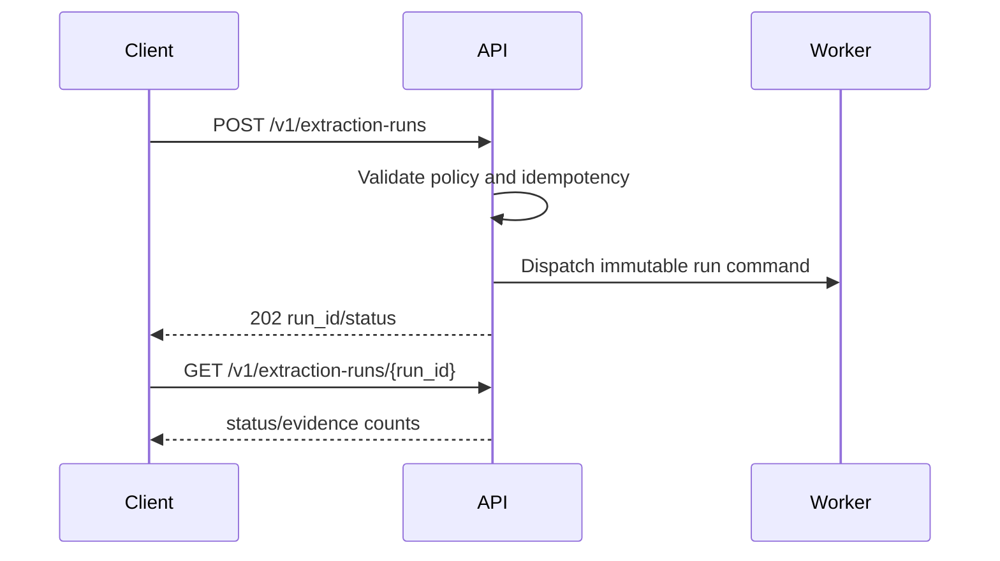

# API Specification

## API conventions

FastAPI exposes versioned REST JSON endpoints. IDs are UUIDs or ULIDs. Mutations accept optional `Idempotency-Key`; timestamps use UTC ISO-8601; pagination uses cursor/limit. Pydantic v2 separates create, update, response, and internal models.

## Endpoint catalog

| Method and path | Purpose |
|---|---|
| POST /v1/leads/import | Start a provenance-bearing lead import |
| GET /v1/leads/{lead_id} | Retrieve lead and evidence summary |
| POST /v1/extraction-runs | Start an extraction run |
| GET /v1/extraction-runs/{run_id} | Get run status and audit summary |
| POST /v1/campaigns/{campaign_id}/pause | Pause queued work |
| POST /v1/leads/{lead_id}/approve | Record authorized promotion approval |

Phase 1 also exposes campaign source-policy and source registration contracts:

| Method and path | Purpose |
|---|---|
| POST /v1/campaigns | Create a campaign |
| POST /v1/campaigns/{campaign_id}/pause | Pause campaign work |
| POST /v1/campaigns/{campaign_id}/source-policy | Create the campaign source policy |
| POST /v1/campaigns/{campaign_id}/sources | Register a policy-approved source |

Phase 3 recommendation-only agent contracts:

| Method and path | Purpose |
|---|---|
| POST /v1/agent-runs | Run a bounded recommendation graph with mock or Ollama provider |
| GET /v1/agent-runs/{run_id} | Retrieve provider, budget, citation, and terminal outcome metadata |

Agent runs may use read-only tools only. Approval, merge, export, retention, source
registration, and other domain mutations remain unavailable to agent tools.

Phase 4 operation contracts:

| Method and path | Purpose |
|---|---|
| GET /health/live | Report process liveness without dependency checks |
| GET /health/ready | Report database readiness |
| GET /metrics | Return lightweight application metrics |
| POST /v1/operations | Register an idempotent bounded durable operation |
| GET /v1/operations/{operation_id} | Retrieve durable operation status |
| POST /v1/campaigns/{campaign_id}/retention-policy | Create or update campaign retention controls |
| GET /v1/campaigns/{campaign_id}/retention-policy | Retrieve campaign retention controls |
| POST /v1/campaigns/{campaign_id}/export | Export public lead identifiers when policy enables export |
| POST /v1/leads/{lead_id}/archive | Archive a lead when deletion policy permits it |
| POST /v1/campaigns/{campaign_id}/purge | Purge eligible archived leads with explicit confirmation |

Phase 5 expansion and optimization contracts:

| Method and path | Purpose |
|---|---|
| POST /v1/expansion-releases | Register a policy-evidenced expansion release at zero rollout |
| GET /v1/expansion-releases/{release_id} | Retrieve release status and rollout metadata |
| POST /v1/expansion-releases/{release_id}/stage | Increase rollout after approved evidence gates |
| POST /v1/expansion-releases/{release_id}/pause | Pause an active staged release |
| POST /v1/expansion-releases/{release_id}/resume | Resume a paused staged release |
| POST /v1/expansion-releases/{release_id}/disable | Disable a release immediately |
| POST /v1/expansion-releases/{release_id}/rollback | Roll back rollout and preserve audit evidence |
| POST /v1/resource-budgets | Create or update campaign worker concurrency, rate, byte, token, and spend ceilings |

## Error model

Return stable codes, correlation IDs, field errors, retry hints, and no raw secrets or prompts. Use 400 validation, 401 authentication, 403 authorization/policy, 409 conflict, 422 semantic validation, 429 rate limit, 503 dependency, and 202 async responses.
