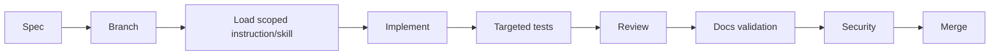

# Development Workflow

## Local development

Implementation starts after this harness is accepted. The minimum setup pins Python 3.12+, a virtual environment, FastAPI, SQLModel, SQLite, Windows-host Ollama with `qwen3:0.6b`, Playwright browsers, migrations, and isolated test credentials. PostgreSQL, Redis, and Celery are production/deferred services unless a slice explicitly tests those contracts. Never commit `.env` secrets or browser state.

Before starting infrastructure, check the Docker Desktop memory limit and use the [RND container profiles](13-deployment-and-infrastructure.md#rnd-docker-desktop). The minimum core stack is `FastAPI + SQLModel + SQLite`; Ollama runs on the Windows host and Playwright, storage, observability, and production queue services remain separate profiles.

## Contribution workflow

Each change states requirements, affected domain/contracts, threat/cost impact, test plan, migration plan, and rollback. Update tests and direct documentation with code. Prefer narrow changes over unsolicited refactoring.

## Quality gates

- Documentation validator passes.
- Type, format, lint, unit, and relevant integration checks pass.
- Database migrations are reversible or explicitly documented.
- Security review signs off on policy/browser/provider/auth changes.
- Architecture decisions record major technology or boundary changes.
- Evaluation and cost thresholds are not silently relaxed.
