# Roadmap

## Delivery principles

- Start with specification-ready contracts and deterministic behavior; no application slice begins before the implementation gate in [Implementation Readiness](implementation-readiness.md).
- Develop the local profile first with FastAPI, SQLModel, SQLite, host Ollama, and Playwright only when a slice requires it.
- Finish one vertical, policy-safe slice before widening source, provider, data-class, or automation coverage.
- Keep API, domain, persistence, migration, test, documentation, security, cost, and rollback evidence in the same delivery slice.
- Agents may recommend and orchestrate work but deterministic services retain mutation and authorization authority.
- Live crawling and personal-data collection remain disabled until source approval, data classification, threat review, fixture coverage, and legal/privacy review are complete.

## Delivery sequence

```mermaid
flowchart LR
  Foundation[Phase 1: foundations] --> Domain[Phase 1: domain contracts]
  Domain --> Deterministic[Phase 2: deterministic pipeline]
  Deterministic --> Browser[Phase 2: policy browser extraction]
  Browser --> Review[Phase 2: human review]
  Review --> Agent[Phase 3: MCP and bounded agents]
  Agent --> Evaluation[Phase 3: offline evaluation]
  Evaluation --> Hardening[Phase 4: security and operations]
  Hardening --> Release[Production release gate]
  Release --> Expansion[Phase 5: controlled expansion]
```

Every phase produces executable evidence. Documentation alone does not mark a capability as implemented.

## Delivery workstreams

The workstreams overlap only when contracts are stable and an earlier gate is complete:

1. **Architecture and contracts:** package layout, settings, boundaries, schemas, migrations, ADRs, and API conventions.
2. **Data and policy:** domain entities, provenance, retention, source allowlisting, authorization, idempotency, and audit events.
3. **Pipeline and browser:** deterministic parsing, normalization, entity resolution, isolated fixtures, and policy-controlled extraction.
4. **AI and automation:** provider adapters, MCP tools, bounded graphs, budgets, fallback, and offline evaluation.
5. **Quality and operations:** tests, observability, security review, deployment, recovery, cost measurement, runbooks, and ownership.

## Definition of ready

Before an implementation slice starts, record:

- Requirements and domain/API contracts covered by the slice.
- Source, destination, data-class, secret, and authorization assumptions.
- Package manifest, package layout, dependencies, and migration impact.
- Test fixtures, expected success/failure outcomes, and evaluation thresholds.
- Threat, privacy, browser, provider, cost, and rollback impact.
- Owner, reviewer, and definition of done.

## Delivery phases

## Phase 1

Establish the executable local foundation and the first typed domain contracts.

### Step 1.1: Repository and RND foundation

- Confirm Python 3.12+, virtual-environment conventions, dependency policy, and package layout.
- Add the application package manifest and core `src/` or equivalent modules without adding production-only infrastructure.
- Configure typed Pydantic settings, structured logging, correlation IDs, and FastAPI application lifecycle.
- Provide the minimum FastAPI, SQLModel, and SQLite composition from the documented local profile.
- Add a health endpoint, Alembic setup, test database lifecycle, and deterministic configuration for Windows-host Ollama and optional Playwright.
- Keep PostgreSQL, Redis, Celery, object storage, and observability services deferred unless a contract requires them.

### Step 1.2: Core persistence and domain contracts

- Implement migrations and typed repositories for `Campaign`, `Source`, `SourcePolicy`, `ExtractionRun`, `Evidence`, `Company`, `Contact`, `Lead`, and `Approval` as justified by the slice.
- Define create/update/response Pydantic models, stable API error models, UTC timestamps, and UUID or ULID identifiers.
- Add immutable run commands, provenance-bearing records, correction semantics, append-only audit events, and idempotency keys.
- Add transaction boundaries and migration compatibility checks before adding API behavior.
- Preserve promotion as an approval transition rather than a direct lead mutation.

### Step 1.3: API and policy foundation

- Implement campaign, source-policy, extraction-run, lead retrieval, pause, import, and approval endpoints from the API specification.
- Enforce authentication, tenant/campaign authorization, data-class checks, source allowlisting, and field allowlists in service boundaries.
- Return typed outcomes for validation, denial, conflict, not-found, transient failure, timeout, and policy rejection.
- Add API integration tests, contract snapshots, migration tests, and audit/authorization negative cases.

### Phase 1 exit criteria

- Core migrations, rollback procedure, API contract tests, repository/service boundaries, provenance model, source-policy enforcement, deterministic fixtures, audit foundations, and CI quality gates pass.
- The local profile runs with SQLite only and does not require PostgreSQL, Redis, Celery, MinIO, or Ollama containers.
- Live extraction, personal-data collection, external writes, and promotion remain disabled.

## Phase 2

Build the deterministic evidence and extraction pipeline before connecting browser or model automation.

### Step 2.1: Policy-gated discovery contracts

- Implement discovered-source candidates and policy approval state with campaign, run, URL, data class, and access-basis metadata.
- Reject private destinations, unsupported schemes, denied sources, missing policies, and unbounded crawl settings.
- Add discovery fixtures covering allow, deny, conflict, malformed input, rate limit, and policy-change cases.

### Step 2.2: Fixture extraction and normalization

- Implement immutable extraction-run and artifact contracts with source, timestamp, extractor, model/version, raw artifact hash, and normalization version.
- Build deterministic parsers and validators before invoking any LLM.
- Normalize websites, business entities, addresses, roles, email, and phone records without weakening data minimization.
- Store raw bytes or hashes only according to approved retention and storage policy.
- Add malformed HTML, challenge, timeout, content-type, encoding, extraction conflict, and duplicate fixtures.

### Step 2.3: Entity resolution and human review

- Resolve deterministic canonical identifiers and domains first, then exact normalized identities, then configurable similarity candidates.
- Require threshold, conflict check, audit data, and reversal information before any merge.
- Build candidate, quarantine, review, approve, reject, archive, and retention transitions from the domain lifecycle.
- Expose review queue evidence, provider/rule explanation, provenance, conflict reasons, and correction actions.
- Prevent a lead from entering the retained lifecycle without approval and provenance-bearing evidence.

### Step 2.4: Policy-controlled browser extraction

- Implement fresh Playwright contexts, fixed timeouts, network and artifact capture, page-byte limits, cleanup, and challenge detection.
- Start browser work only after source and destination policy checks pass.
- Record browser/parser versions, status, content type, bytes, hashes, retries, and terminal typed outcomes.
- Add isolated browser fixtures and tests for SSRF, private networks, injection-like content, challenge pages, redirect changes, timeouts, retries, and cleanup.

### Phase 2 exit criteria

- Fixture extraction, challenge detection, complete provenance, explainable duplicate candidates, retention metadata, authorization checks, and no live-source bypass pass.
- Browser automation cannot navigate unapproved destinations or capture authentication/sensitive content outside authorized fields.
- Manual review can quarantine, correct, reject, approve, archive, export, and trace records.

## Phase 3

Add bounded AI orchestration and replaceable external boundaries only after deterministic pipeline contracts are stable.

### Step 3.1: MCP capability contracts

- Implement narrow MCP schemas for campaign, discovery, policy, extraction, browser, evidence, lead, approval, and artifact tools.
- Enforce caller identity, tenant scope, side-effect class, idempotency, authorization, timeouts, and typed tool outcomes.
- Add contract and authorization tests for denied tools, invalid fields, transient failures, conflicts, and unexpected payloads.

### Step 3.2: Provider and graph adapters

- Implement a provider abstraction behind Ollama and hosted-provider adapters.
- Integrate LangGraph for plan, inspect, retrieve, evaluate, verify, recommend, escalate, and bounded recovery states.
- Apply step, tool, token, wall-time, byte, concurrency, retry, and spend ceilings.
- Store prompt/model/provider versions, tool allowlists, redaction flags, citations, terminal outcome, and budget usage.

### Step 3.3: Evaluation and fallback

- Create offline extraction, normalization, deduplication, qualification, policy, prompt-injection, and tool-selection datasets.
- Compare provider/model results against fixed baselines before choosing fallback or quality changes.
- Measure precision, recall, completeness, schema validity, provenance completeness, merge harm, calibration, success, validity, fallback, cost, and latency.
- Configure thresholds in CI/evaluation; changing a threshold requires reviewed evidence.

### Phase 3 exit criteria

- Step/token/tool/byte/time/spend budgets, provider fallback, policy-denied tools, evidence grounding, typed terminal outcomes, and offline quality thresholds pass.
- The 0.6B local model is the default evaluation baseline; larger models require a documented quality or cost threshold failure.
- Agent mutations do not bypass deterministic policy, approval, audit, or mutation boundaries.

## Phase 4

Phase 4 implementation is active in the repository. Executable slices cover
PostgreSQL pool configuration, migration compatibility, Docker smoke coverage,
readiness and metrics endpoints, durable operation contracts, split
Redis/Celery worker profiles, retention policies, export/archive controls, and
audited purge behavior. Security review, production legal approval, backup
automation, alerting, and operational ownership remain release gates.

Harden production behavior, operating controls, deployment, security, and recovery.

### Step 4.1: Production persistence and execution

- Validate PostgreSQL migrations, SQLModel compatibility, connection bounds, transactions, backups, and rollback.
- Add Redis/Celery contracts only after durable scheduling, concurrency, retry recovery, or restart behavior requires them.
- Separate browser, default, agent, and review queues by pool and resource profile; apply source and campaign backpressure.
- Add S3-compatible storage or keep local filesystem storage for a documented deployment profile.

### Step 4.2: Security, privacy, and compliance readiness

- Complete threat modeling, dependency review, secrets scanning, SSRF/browser isolation, prompt-injection, authorization, audit, retention, deletion, export, and recovery tests.
- Separate public business facts from personal or sensitive data with purpose and retention metadata.
- Add correction, export, deletion, restoration, and purge workflows under authorization.
- Obtain qualified legal/privacy review before personal fields or production sources are enabled.

### Step 4.3: Observability, cost, and operations

- Add trace and metric correlation across API, worker, browser, pipeline, agent, MCP, provider, database, and storage.
- Define SLOs and alerts for availability, freshness, queue lag, browser/provider failures, evidence completeness, budget exhaustion, and policy violations.
- Measure cost by campaign, source, run, worker, provider/model, browser context, artifact, network, database, and human review.
- Produce dashboards, operational ownership, backup/restore tests, incident drills, and runbooks.

### Phase 4 exit criteria

- Load, migration, restore, queue-loss, browser/provider-outage, retention, purge, incident, and authorization scenarios pass.
- Security/privacy review, legal review status where required, dashboards/alerts, cost projections, rollback, release ownership, and runbooks are approved.
- Release evidence covers unit, integration, contract, browser, evaluation, migration, security, performance, recovery, and cost gates.

## Phase 5

Phase 5 implementation is complete at the executable-contract stage. Implemented
contracts provide policy-evidenced source and public-field expansion releases,
approved-to-staged rollout, pause/resume/disable/rollback actions, and campaign
worker resource budgets. Live source discovery, personal fields, external writes,
and production adapter switching remain disabled until their independent
authorization and regression gates pass.

Expand only source and enrichment coverage supported by policy and measured evidence.

### Step 5.1: Controlled expansion

- Add sources or fields in small batches behind source-policy approvals and fixture/evaluation coverage.
- Add provider, browser, parser, storage, or queue adapters through ADRs only when contracts justify a boundary change.
- Stage rollout by campaign, tenant, source, or risk class; pause work for policy, quality, cost, or dependency regressions.
- Preserve rollback and disable controls for each new source, model, field, or enrichment type.

### Step 5.2: Operational optimization

- Increase concurrency only within measured browser, provider, database, queue, cost, and memory budgets.
- Expand cache, batching, provider fallback, model size, or retention profiles only after offline and production regression checks.
- Review review-queue backlog, merge harm, quality drift, budget utilization, abuse signals, and source health continuously.

### Phase 5 exit criteria

- Expansion has approved policy coverage, fixture and evaluation evidence, measured quality/cost results, staged rollout, rollback readiness, and documented operational ownership.
- No expansion weakens source policy, authorization, evidence provenance, retention, human review, or cost controls.
