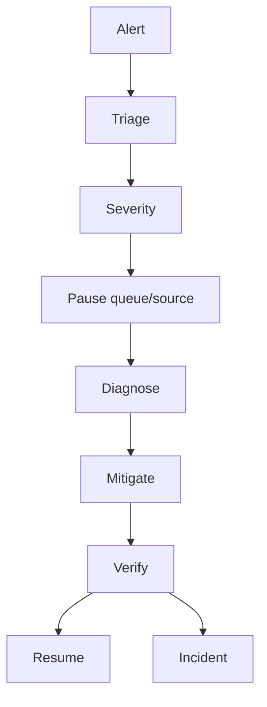

# Operational Runbook

## Operational ownership

Platform operators own availability/workers; browser owners source compliance; data owners lead retention/correction; security owns incidents; AI owners provider/evaluation quality.

## Routine operations

- Pause/resume campaigns and source classes.
- Drain or requeue bounded transient jobs with original run/config IDs.
- Inspect challenge, artifact, queue, provider, and database metrics.
- Review duplicate and promotion queues before exports.
- Reconcile backup and retention/deletion jobs.
- Rotate provider/API credentials and revoke compromised sessions.

## Incident playbooks

**Browser outage or block:** pause affected source/campaign, preserve run and artifact hashes, verify policy, and retry only under approved domain/rate controls.

**Provider outage:** use local provider or disable model recommendations while keeping deterministic pipeline and status visible.

**Data leak or unauthorized export:** revoke tokens/credentials, isolate storage and queues, preserve audit evidence, notify incident owner, execute required revocation/deletion, and hold review.

**Queue backlog:** reduce browser/provider concurrency, inspect source throttles, defer new work, and resume from checkpoint IDs.

**Database migration failure:** stop writes if compatibility is uncertain, restore a compatible service version, inspect locks/backups, and execute approved rollback.
