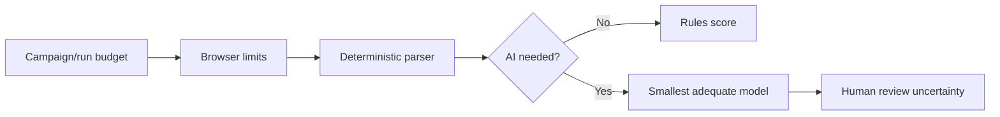

# Cost Optimization

## Cost model

Track cost by campaign, source, run, worker, provider/model, browser context, artifact storage, network bytes, database volume, and human review minutes. Separate estimated and measured cost.

## Budget controls

Limit model calls by token/spend ceilings and evidence thresholds. Browser runs have page count, bytes, elapsed time, and concurrency budgets. Storage lifecycle expires raw content/screenshots; exports are audited and rate-limited.

## Optimization policies

- Run deterministic parsing/policy before AI.
- Use local Ollama for eligible workloads after quality verification.
- Select the smallest provider/model meeting evaluation thresholds.
- Cache source policies and parser contracts, not sensitive raw pages.
- Batch low-risk independent jobs while preserving source rate controls.
- Pause low-value campaigns at budget limits and require renewal.

## Cost quality gate

A feature needs cost/latency estimates and measurements. A model/provider change requires offline regression comparison, thresholds, fallback, and spend ceiling.

Phase 5 adds campaign-scoped resource budgets for default, browser, and model
worker pools. Expansion releases remain at zero rollout until approval evidence
is registered; staged percentages are only operational rollout metadata, not an
authorization to bypass source, field, extraction, or model policy gates.
