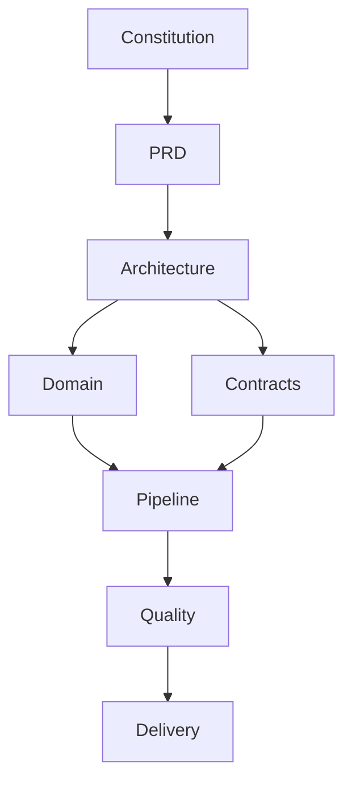

# Documentation Index

This directory is the authoritative product and engineering specification. Start with the constitution, then follow requirements, architecture, domain, and implementation contracts.

For laptop development, the minimum stack is FastAPI, SQLModel, SQLite, host Ollama with `qwen3:0.6b`, and Playwright; production PostgreSQL/Redis/Celery services remain explicit deployment profiles.

## Reading order

1. [Project Constitution](00-project-constitution.md)
2. [Product Requirements](01-product-requirements-document.md)
3. [System Architecture](02-system-architecture.md)
4. [Domain Model](03-domain-model.md)
5. [Agentic Workflow](04-agentic-workflow.md), [Context Engineering](05-context-engineering.md), and [Agent Harness Engineering](06-agent-harness-engineering.md)
6. [MCP Architecture](07-mcp-architecture.md), [Playwright Extraction](08-playwright-extraction.md), and [Data Pipeline](09-data-pipeline.md)
7. [Security and Compliance](10-security-and-compliance.md), [Observability](11-observability.md), [Testing and Evaluation](12-testing-and-evaluation.md), [Deployment](13-deployment-and-infrastructure.md), [API](14-api-specification.md), [Development Workflow](15-development-workflow.md), [Operational Runbook](17-operational-runbook.md), and [Cost Optimization](18-cost-optimization.md).
8. [Implementation Readiness](implementation-readiness.md) determines whether the first slice may proceed.

