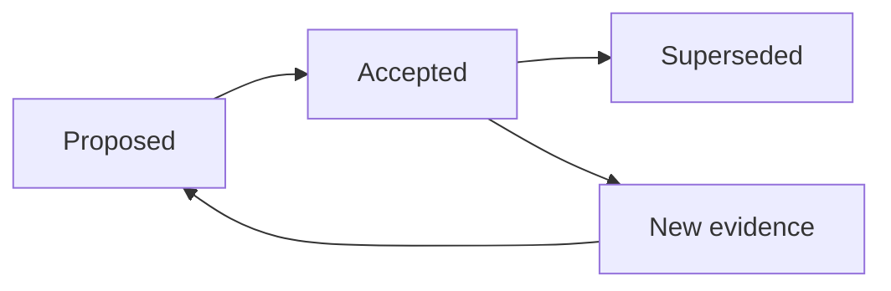

# Architecture Decision Records

ADRs record consequential architecture decisions. Proposed changes use `Status: Proposed`; accepted decisions use `Status: Accepted`; superseded decisions link to replacements. Include context, options, decision, consequences, and revisit triggers.

| ADR | Decision area |
|---|---|
| [ADR-001](ADR-001-agent-orchestration.md) | LangGraph, deterministic workflows, and bounded orchestration |
| [ADR-002](ADR-002-database-and-persistence.md) | SQLModel, SQLite RND, PostgreSQL production, Alembic, and persistence boundaries |
| [ADR-003](ADR-003-browser-automation.md) | Playwright isolation and extraction workers |
| [ADR-004](ADR-004-mcp-integration.md) | MCP tool boundaries and integration policy |
| [ADR-005](ADR-005-task-queue.md) | Redis, Celery, scheduling, retries, and dead-letter handling |
| [ADR-006](ADR-006-llm-provider-abstraction.md) | Ollama and configurable model provider adapters |
| [ADR-007](ADR-007-local-rnd-profile.md) | FastAPI, SQLModel/SQLite, host Ollama, Playwright, and minimal RND services |

