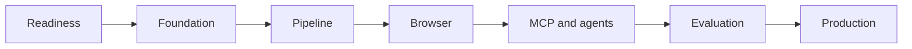

# Implementation Readiness

## Status

The repository is specification-ready and the Phase 1 local RND foundation plus the deterministic Phase 2 contracts are implemented. This status does not authorize live scraping, personal-data collection, external writes, or production handling.

Phase 1 provides the FastAPI foundation, file-backed SQLModel/SQLite persistence, Alembic core migration, campaign/source-policy/source/extraction-run contracts, approval audit, and local acceptance tests. Browser automation, MCP tools, LangGraph orchestration, hosted production persistence, queue services, live discovery, and personal-field collection remain outside Phase 1.

The API-only Docker smoke profile is defined by `Dockerfile` and `compose.yml`. Docker validation is limited to FastAPI, Alembic/SQLite, health checks, and API contracts; browser, model, production queue, storage, and observability containers remain deferred to their relevant implementation phases.

Phase 2 now includes fixture HTML parsing, immutable artifact staging, hashed evidence provenance, domain/name normalization, deterministic entity-resolution precedence, reversible merge decisions, private-network/browser policy checks, challenge detection, fixed browser budgets, and isolated Playwright lifecycle code. Live browser navigation remains disabled until source authorization and fixture security gates are explicitly approved.

Phase 3 implementation has started with a bounded LangGraph/MCP-style tool
gateway, replaceable mock and Ollama provider contracts, typed agent-run
persistence, fixed budgets, and offline tool/policy/schema evaluation fixtures.
The graph is recommendation-only: lead approval, merge, export, retention, and
source-policy mutations remain outside agent tool access.

## Implementation gate

Implementation may begin only when package layout and dependency policy are confirmed, source allowlisting is approved, data classification is recorded, fixture sets exist, and CI quality thresholds are configured. Security/privacy review is mandatory before personal fields or live sources are enabled.

## Required before implementation

- Confirm package layout and dependency policy.
- Add a package manifest only when implementation starts.
- Implement core entity migrations and API schemas before agent/browser code.
- Configure source policy and data classification.
- Create deterministic fixtures for tests and Playwright extraction.
- Define CI thresholds and provider/model evaluation datasets.
- Conduct threat/privacy review before personal fields are collected.
- Establish ownership, secrets handling, and rollback criteria for the first slice.

## Recommended first slices

1. Local RND foundation: FastAPI settings, SQLModel/SQLite health, migrations, audit foundations, and deterministic local fixtures.
2. Campaign, Source, ExtractionRun, policy, and provenance contracts.
3. Deterministic parser/normalizer and fixture pipeline.
4. Idempotent local tasks, then Celery/PostgreSQL/S3 production adapters.
5. MCP contracts and policy-gated browser tools.
6. Bounded LangGraph graph and Ollama provider adapter.
7. Observability, retention, deployment, and operational drills.

Each slice must preserve the Constitution and must include tests, migration/rollback notes, documentation updates, and release evidence before the next slice starts.

